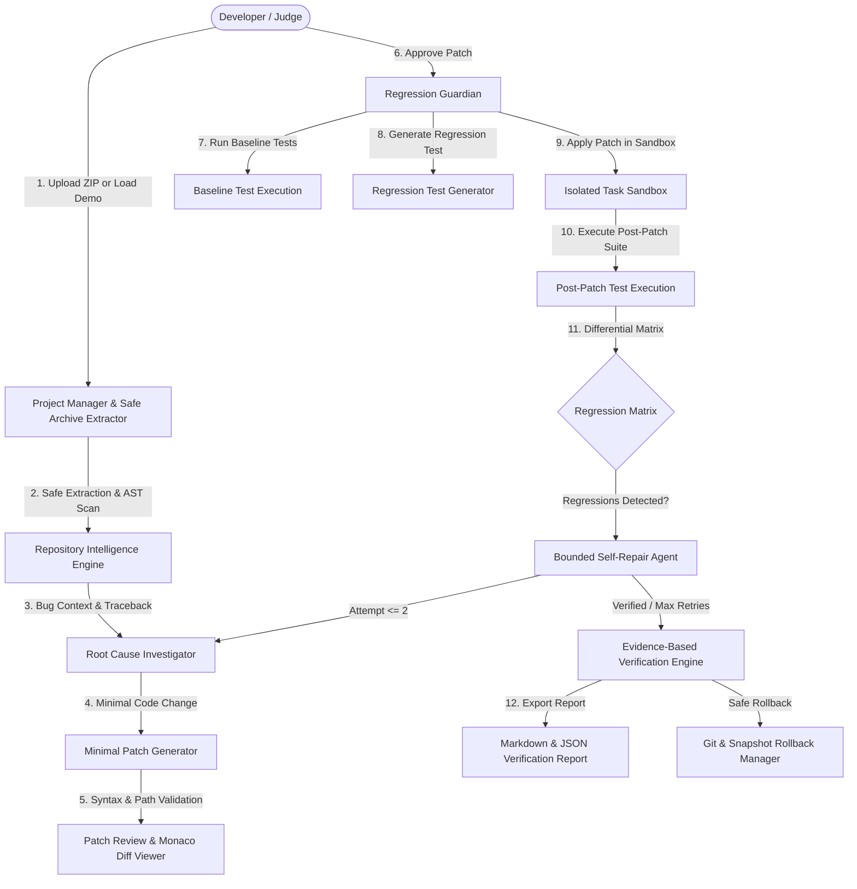

# CodePilot AI — Autonomous Software Engineering Agent

> **"Fix the bug. Verify the change. Trust the evidence."**

**CodePilot AI** is a full-stack, autonomous software engineering platform built for Problem Statement **PSI09: AI Software Engineering Agent**. It accepts Python repositories via ZIP upload, scans symbols using AST analysis, investigates root causes using AI reasoning, synthesizes minimal code patches, enforces strict human-in-the-loop approval with a side-by-side Monaco Diff Viewer, and guarantees software stability through **Regression Guardian**—differential pre-patch vs. post-patch test execution in an isolated sandbox.
z
---

## 🚀 Key Innovations & Architecture



1. **Regression Guardian (Core Innovation)**:
   - Compares test suite behavior **before** and **after** applying the candidate patch.
   - Generates targeted reproduction test cases.
   - Detects regressions: flags immediately if a previously passing baseline test begins to fail (`REGRESSION_DETECTED`).
   - Distinguishes verified fixes (`FIX_VERIFIED`) from unverified claims. Never hallucinates test success.
2. **Safe Isolated Subprocess & Sandboxing**:
   - Creates an isolated task sandbox workspace per attempt.
   - Timeouts (30s) and command policy allowlisting prevent runaway executions.
   - Safe archive validator blocks directory traversal (`../`), symlinks, and masks `.env` secrets.
3. **Dual AI Reasoning Engine**:
   - Supports Google Gemini API and OpenAI API when credentials are provided.
   - **Zero-Config Offline Fallback**: Features an intelligent AST static reasoning engine that performs deep structural AST parsing and bug remediation for hackathon environments without requiring API keys.
4. **Professional Light Developer SaaS UI**:
   - Built with React 19, Vite, TypeScript, Tailwind CSS, Monaco Editor, and Recharts.
   - Clean color palette (`#F7F8FC` background, `#FFFFFF` cards, `#5B5CE2` primary accent).

---

## 🛠️ Technology Stack

- **Frontend**:
  - React 19 + TypeScript + Vite
  - Tailwind CSS v4
  - Monaco Editor & Monaco Diff Editor (`@monaco-editor/react`)
  - Lucide React icons
  - React Router v7
  - Recharts
  - Axios
- **Backend**:
  - Python 3.14 / 3.11+
  - FastAPI + Uvicorn
  - SQLAlchemy + SQLite
  - Pydantic v2
  - Python AST (`ast` module)
  - Pytest runner
  - Isolated subprocess sandbox runner

---

## 📋 Windows PowerShell Quickstart Instructions

### 1. Prerequisites
- Python 3.11+ (verified on Python 3.14)
- Node.js v18+ & npm
- Git

---

### 2. Backend Setup
From the project root directory (`HACKNEX`):

```powershell
# Step 1: If PowerShell restricts script execution, allow it for this process:
Set-ExecutionPolicy -ExecutionPolicy RemoteSigned -Scope Process

# Step 2: Create virtual environment (if not already created):
python -m venv .venv

# Step 3: Activate virtual environment:
.venv\Scripts\Activate.ps1

# Step 4: Install backend dependencies:
pip install -r backend\requirements.txt

# Step 5: (Optional) Set up environment variables
# If omitted, CodePilot runs in offline AST Static Engine mode automatically!
Copy-Item backend\.env.example backend\.env
# Or for project root:
Copy-Item .env.example .env

# Step 6: Start the FastAPI backend server
python -m uvicorn app.main:app --app-dir backend --reload --port 8000
```

> **Alternative (Direct execution without activation)**:
> ```powershell
> .venv\Scripts\python.exe -m uvicorn app.main:app --app-dir backend --reload --port 8000
> ```

- **Backend API URL**: `http://localhost:8000`
- **Interactive Swagger Docs**: `http://localhost:8000/docs`

---

### 3. Frontend Setup
In a **new PowerShell terminal window**, navigate to the `frontend` folder:

```powershell
# Step 1: Navigate to the frontend directory
cd frontend

# Step 2: Install dependencies (if not already installed)
npm install

# Step 3: Start Vite development server
npm run dev
```

- **Frontend Application URL**: `http://localhost:5173`

---

## 🧪 Running Automated Tests

From the project root directory (`HACKNEX`):

```powershell
# Run the complete backend test suite (22 tests covering archive validation, health, language detection, and regression guardian)
.venv\Scripts\pytest.exe -v backend\tests\
```

To verify the frontend TypeScript build:
```powershell
cd frontend
npm run build
cd ..
```

---

## 📦 Repository Upload & Validation Capabilities

CodePilot AI includes enterprise-grade repository ingestion and validation:
- **Supported Formats**: Standard ZIP archives up to 25 MB (uncompressed max 50 MB, up to 500 extractable files).
- **Flexible Path Handling**: Fully supports Windows backslashes (`\`), nested directory structures, spaces in folder/file names, and top-level root directory wrappers (e.g. `repo-main/` from GitHub ZIP downloads).
- **Security & Secret Stripping**: Automatically blocks Unix/Windows path traversal (`../../`, `..\..\`, drive letters like `C:\`), symlink directory escapes, and excludes `.git/`, `node_modules/`, and `.env` credentials.
- **Language Diagnostics**: CodePilot AI currently investigates and tests Python codebases (`.py` files). If a valid ZIP containing only another language (such as JavaScript/TypeScript) is uploaded, the platform safely verifies the archive and returns an informative diagnostic message rather than a generic upload error:
  > *"ZIP uploaded successfully, but no Python files were found. This scanner currently supports Python repositories (detected: JavaScript/TypeScript)."*

---

## 🎯 30-Second Hackathon Demo Walkthrough

1. Open `http://localhost:5173` in your browser.
2. In the top bar or Overview dashboard, click **"Load Demo Project"**.
   - This automatically provisions the **ShopPilot Pricing Engine** repository with an off-by-one boundary bug (`total > 100` instead of `>= 100`).
3. Click **"Explore"** on the project card to view the repository in the Monaco Code Viewer.
4. Click **"Investigate Bug on this Repo"** or go to **New Analysis**:
   - Click **"Fill Sample Bug (Demo)"** to automatically populate the bug description: *"Orders of exactly $100 fail to receive Tier-1 discount"*.
   - Select **"Patch + Regression Guardian"** mode and click **"Start Investigation"**.
5. Inspect the generated minimal patch in the **Monaco Side-by-Side Diff Viewer**:
   - Notice the green additions modifying `total > 100` to `total >= 100`.
6. Click **"Approve & Run Guardian"**:
   - The agent creates a clean isolated sandbox workspace.
   - Runs baseline tests (`test_calculator.py`).
   - Synthesizes and applies the minimal patch.
   - Generates the targeted regression test.
   - Runs post-patch tests and compares results.
7. View the **Regression Guardian Dashboard**:
   - Watch the verdict update to **`FIX VERIFIED`** with 0 regressions detected.
   - Inspect the differential matrix table and verbose subprocess pytest execution logs.
8. Click **"View Full Evidence Report"** to inspect or download the verifiable report in Markdown or JSON!

---

## 🛡️ Security & DevSecOps Guarantees

- **Path Traversal Protection**: Rejects `../`, absolute drives, and escaping target file paths.
- **Symlink Blocking**: Disallows symlink entries in archives to prevent symbolic link directory escapes.
- **Secret Redaction**: Automatically filters API tokens, passwords, and `.env` credentials from logs and model prompts.
- **Allowlisted Execution**: Restricts commands strictly to allowlisted test runners (`pytest`) within the task sandbox.
- **Safe Rollback**: Takes automated pre-patch snapshots and supports one-click reversal.

---

## 📂 Project Structure

```text
HACKNEX/
├── backend/
│   ├── app/
│   │   ├── api/             # REST endpoints (health, projects, tasks, analysis, patches, verification, reports, history)
│   │   ├── models/          # SQLAlchemy ORM models
│   │   ├── schemas/         # Pydantic v2 schemas
│   │   ├── security/        # Archive validator, path validator, secret redaction, command policy
│   │   ├── services/        # Scanner, AI provider, Regression Guardian, diff engine, test runner, rollback
│   │   ├── config.py        # Centralized settings
│   │   ├── database.py      # Engine and session initialization
│   │   └── main.py          # FastAPI application entry point
│   ├── tests/               # Pytest automated test suite (22 unit & integration tests)
│   ├── requirements.txt
│   └── .env.example
├── frontend/
│   ├── src/
│   │   ├── components/      # Sidebar, Topbar, AppLayout
│   │   ├── pages/           # 9 complete responsive pages
│   │   ├── services/        # Axios API client & typed interfaces
│   │   ├── router.tsx       # React Router v7 routes
│   │   ├── index.css        # Tailwind CSS v4 styling & theme palette
│   │   └── App.tsx
│   ├── package.json
│   ├── vite.config.ts
│   └── .env.example
├── sample_repo/             # Standalone Python sample project
├── codepilot.db             # Local SQLite database
├── .env.example             # Root environment variables template
└── README.md
```

---

## 🔧 Troubleshooting Guide

### 1. `Activate.ps1 cannot be loaded because running scripts is disabled`
PowerShell restricts execution of `.ps1` scripts by default on Windows. Run:
```powershell
Set-ExecutionPolicy -ExecutionPolicy RemoteSigned -Scope Process
```
Or execute Python commands directly using `.venv\Scripts\python.exe`.

### 2. `No module named 'app'` when running Uvicorn
Ensure you pass `--app-dir backend` when running from the root directory:
```powershell
python -m uvicorn app.main:app --app-dir backend --reload --port 8000
```

### 3. "ZIP uploaded successfully, but no Python files were found"
CodePilot AI is optimized for Python repository AST analysis and pytest test execution. Ensure the uploaded ZIP archive contains Python source files (`.py`). If you upload another project type (e.g. JavaScript/TypeScript), CodePilot will indicate the detected language.

### 4. Port 8000 or 5173 already in use
Specify custom ports:
```powershell
# For backend:
python -m uvicorn app.main:app --app-dir backend --port 8001

# For frontend:
npm run dev -- --port 5174
```

---

## 🏆 Hackathon Compliance (Problem Statement PSI09)

- ✅ **Full-Stack Implementation**: Real FastAPI backend + React 19 Vite frontend.
- ✅ **Real Execution**: Real pytest executions in isolated sandboxes with subprocess timeouts.
- ✅ **Evidence-Based**: No fabricated percentages; verifiable test logs and differential test matrices.
- ✅ **Zero-Config Ready**: Runs out of the box on Windows with an intelligent AST Static Engine, with live Gemini/OpenAI toggle.
